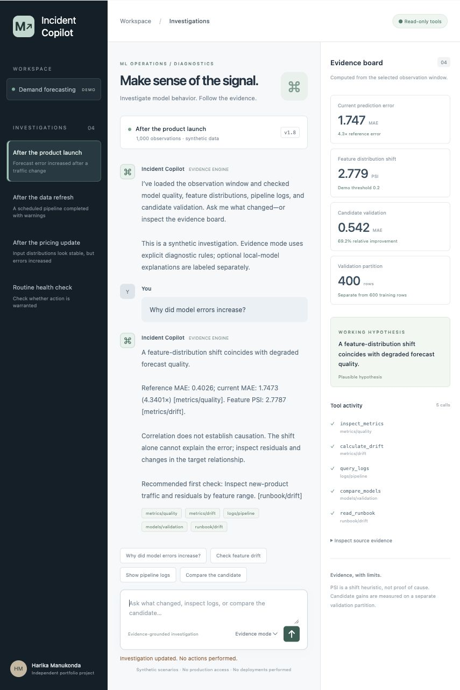
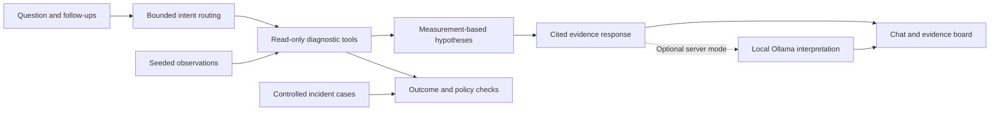

# ML Incident Copilot

An evidence-first conversational application for investigating model-quality incidents. Ask what changed, inspect feature drift and pipeline logs, compare candidate models, and follow cited diagnostic evidence.

**Four controlled synthetic incidents. Five read-only tools. A browser demo with no API key. Optional local-model explanations through Ollama.**



## Start locally

Requires Node.js 22 or newer. No npm dependencies or build step.

```sh
npm test
npm run evaluate
npm start
```

Open http://127.0.0.1:8011. Try “Why did prediction errors increase?”, “Show pipeline logs”, “Compare the candidate”, or “What should I check next?”

Select another incident to reset the conversation and observation window. Click a source chip to inspect its evidence. Export saves a local JSON conversation and diagnostic report. History stays in browser memory; there is no conversation database.

## Two explicit response modes

**Evidence mode (default)** uses deterministic diagnostic rules, calculated metrics, and templated explanations. It is **not generative LLM output**. It handles investigation, drift, logs, candidate comparison, next steps, action refusal, and scope clarification through bounded question patterns. Follow-ups retain the selected incident and support simple references; this is not general conversational reasoning.

Evidence mode runs entirely in the browser, including on GitHub Pages, without sending chat to an inference service. A static-hosting config probe returns unavailable; the app continues in evidence mode.

**Local-model interpretation (optional)** requires Ollama, its running local service, and a model you have already pulled. For example:

```sh
OLLAMA_MODEL=qwen2.5:3b npm start
```

The composer then offers local-model mode. The Node server sends the synthetic evidence, question, and recent turns to Ollama's `/api/chat` endpoint. Its explanation appears separately below the computed evidence response, clearly labeled as unverified. The model cannot call tools or deploy anything. Failed inference is an explicit error, not a silent replacement with a templated answer.

`OLLAMA_BASE_URL` defaults to `http://127.0.0.1:11434`. Changing it to a remote host sends conversation content there. Export variables in your shell; `.env` is not loaded automatically.

The suite contract-tests this adapter with simulated responses. **Real Ollama inference and generated-answer quality were not tested for this release.** The measured report covers evidence mode only.

## Diagnostic tools

| Tool | Evidence |
|---|---|
| `inspect_metrics` | Reference/current MAE and error ratio |
| `calculate_drift` | Feature PSI, mean shift, and exact-zero fraction |
| `query_logs` | Synthetic pipeline and serving-version events |
| `compare_models` | Candidate/incumbent MAE on 400 held-out rows, separate from 600 training rows |
| `read_runbook` | Cited diagnostic steps for the leading hypothesis |

The diagnosis function receives measurements, not incident IDs or ground-truth labels. It prioritizes explicit pipeline faults, stable behavior, distribution shifts with degraded quality, then possible target-relationship changes. The assistant expresses alternatives and uncertainty; these are hypotheses, not causal discovery.

## Controlled scenarios

- **After the product launch:** input distributions shift and nonlinear target behavior degrades the incumbent.
- **After the data refresh:** failed joins default 334 feature records to zero; repair takes priority over retraining.
- **After the pricing update:** monitored inputs stay stable while the input/target relationship changes.
- **Routine health check:** no strong signal warrants intervention.

All data, logs, model versions, and runbooks are synthetic. Labels are immediately available, and only one feature is monitored. PSI 0.2 and error-ratio 1.5 are demo heuristics. The linear candidate may not resolve nonlinear behavior or corrupted inputs. No employer data, production integrations, or deployment capabilities are included.

## Architecture



The earlier [ML Monitoring Lab](https://github.com/harikamanukonda/ml-monitoring-lab) informed the seeded regression experiments, PSI metric, and validation design. This repository implements a conversational workflow in JavaScript so the evidence demo can run on static hosting.

## Evaluation

`npm test` exercises diagnostic logic, metrics, input validation, follow-up state, citation identifiers, action refusal, HTTP errors, and local-model adapter contracts. `npm run evaluate` reproduces `reports/evaluation.json`: 12 designed conversation cases across four incidents.

These checks are narrow regressions on designed fixtures, **not independent generalization results**. Citation validity checks identifier existence, not semantic entailment. No LLM answer accuracy is claimed. The read-only architecture prevents deployments; this is not a production authorization test. GitHub Actions runs the suite and evidence evaluation.

## Hosting

The included Pages workflow publishes the browser-only evidence demo from `web/` and `src/`. The optional Ollama endpoint is unavailable on Pages; use the Node server locally for that mode.

```sh
docker build -t ml-incident-copilot .
docker run --rm -p 127.0.0.1:8011:8011 ml-incident-copilot
```

The Node server binds to loopback by default, bounds request size, rejects cross-origin browser requests, and serves only allowlisted files. Container mode binds internally to all interfaces; the example exposes it only on host loopback. This is a local portfolio application, not an authenticated production incident service. Production use requires appropriate identity, monitoring, and deployment design.

## Files

- `src/metrics.mjs`: seeded sampling, PSI, MAE, and regression.
- `src/scenarios.mjs`: synthetic observations and logs.
- `src/tools.mjs`: read-only tools and trace collection.
- `src/copilot.mjs`: hypotheses and conversational routing.
- `src/llm.mjs`: optional Ollama adapter.
- `server.mjs`: local HTTP server and model proxy.
- `web/`: responsive chat and evidence board.
- `tests/`: behavior, HTTP, and adapter tests.

Reference: [Ollama chat API](https://github.com/ollama/ollama/blob/main/docs/api.md). Project code is MIT licensed.
